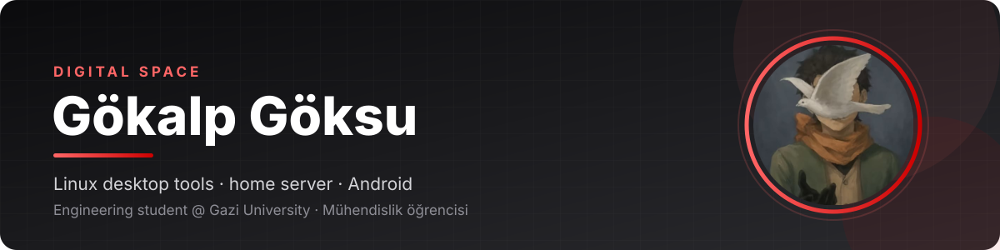

  
  
  

**EN** — I'm an engineering student at Gazi University. I build small, practical tools that make Linux nicer
to live in: desktop extensions, one-command fixes, audio tweaks, and the home server that runs it all.

**TR** — Gazi Üniversitesi'nde mühendislik öğrencisiyim. Linux'u günlük kullanımda daha rahat hale getiren
küçük ve işe yarar araçlar yapıyorum: masaüstü eklentileri, tek komutluk düzeltmeler, ses ayarları ve hepsini
çalıştıran ev sunucusu.

## Featured · Öne çıkanlar

<table>
<tr>
<td width="50%" valign="top">

### [headset-surround-linux](https://github.com/gok8lp/headset-surround-linux)
Virtual 7.1 surround + Dolby-like Cinema mode for any headset, in one command. 
Her kulaklık için tek komutla sanal surround ve Sinema modu. 
`Shell` `PipeWire` `HRTF`

</td>
<td width="50%" valign="top">

### [gnome-island](https://github.com/gok8lp/gnome-island)
Notifications, media and system tools in one capsule for GNOME Shell 50. 
Bildirim, medya ve sistem araçlarını tek kapsülde toplayan GNOME eklentisi. 
`JavaScript` `GNOME Shell`

</td>
</tr>
<tr>
<td valign="top">

### [desktop-server-toolkit](https://github.com/gok8lp/desktop-server-toolkit)
GNOME tweaks, a personal news feed and maintenance tools for desktop + home server. 
Masaüstü ve ev sunucusu için GNOME, haber akışı ve bakım araçları. 
`JavaScript` `GNOME` `systemd`

</td>
<td valign="top">

### [clipline-linux](https://github.com/gok8lp/clipline-linux)
Unofficial Wayland/Hyprland port of ClipBoardLine: keyboard-first clipboard shelves. 
ClipBoardLine'ın Linux (Wayland/Hyprland) uyarlaması. 
`JavaScript` `Electron` `Wayland`

</td>
</tr>
<tr>
<td valign="top">

### [home-server](https://github.com/gok8lp/home-server) + [android](https://github.com/gok8lp/home-server-android)
Docker, systemd, backups, monitoring and VMs, plus an Android client to watch them. 
Ev sunucusu yapılandırmaları ve onu izleyen Android istemcisi. 
`Python` `Kotlin` `Docker`

</td>
<td valign="top">

### [koharia-reader](https://github.com/gok8lp/koharia-reader)
Personal Android reader based on Mihon, with Komga, Kavita and local libraries. 
Komga, Kavita ve yerel kitaplık destekli kişisel Android okuyucu. 
`Kotlin` `Android`

</td>
</tr>
</table>

## One-command Linux fixes · Tek komutluk Linux araçları

| | |
|---|---|
| [ubuntu-tam-guncelle](https://github.com/gok8lp/ubuntu-tam-guncelle) | Update everything on Ubuntu: apt, snap, flatpak, firmware · *Ubuntu'yu tek komutla tamamen günceller* |
| [chrome-orta-tik-kaydirma](https://github.com/gok8lp/chrome-orta-tik-kaydirma) | Middle-click autoscroll for Chrome on Linux · *Chrome'a orta tuşla kaydırma* |
| [gnome-pip-konum](https://github.com/gok8lp/gnome-pip-konum) | Chrome picture-in-picture opens where you left it (multi-monitor) · *PiP pencereleri son konumunda açılır* |
| [k380s-ubuntu-fn](https://github.com/gok8lp/k380s-ubuntu-fn) | Logitech K380s top-row keys fully working on GNOME/Wayland · *K380s üst sıra tuşları* |
| [end4-pC](https://github.com/gok8lp/end4-pC) | My Hyprland/Caelestia desktop setup with restore docs · *Hyprland masaüstü yapılandırmam* |

## Toolbox · Araçlar

  
  
  
  
  
  
  
  
  
  
  
  

<b>Learning projects · Öğrenme projeleri</b>

 

| | |
|---|---|
| [cybersecurity-lab](https://github.com/gok8lp/cybersecurity-lab) | Security lessons, puzzles and an isolated lab · FastAPI + React |
| [c-process-tree](https://github.com/gok8lp/c-process-tree) | Process trees with POSIX `fork` and file-based IPC |
| [java-producer-consumer](https://github.com/gok8lp/java-producer-consumer) | Producer/consumer with `Thread` and `synchronized` |
| [c-calismalarim](https://github.com/gok8lp/c-calismalarim) · [c-text-shuffler](https://github.com/gok8lp/c-text-shuffler) · [c-password-generator](https://github.com/gok8lp/c-password-generator) | C exercises · C alıştırmaları |
| [gok8lp.github.io](https://github.com/gok8lp/gok8lp.github.io) · [wix-anilist-portfolio](https://github.com/gok8lp/wix-anilist-portfolio) | Personal site experiments · Kişisel site denemeleri |

